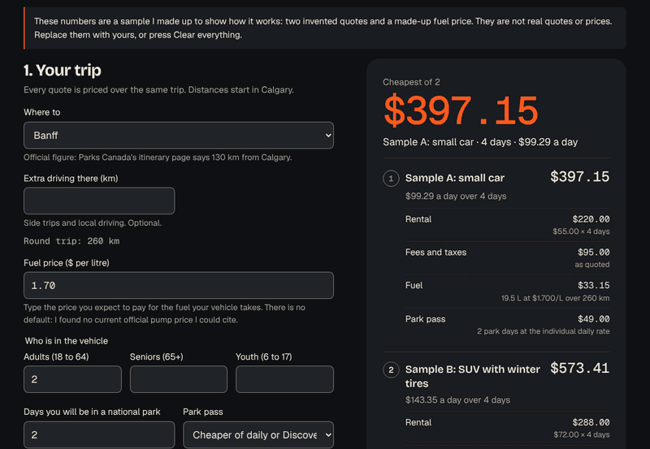
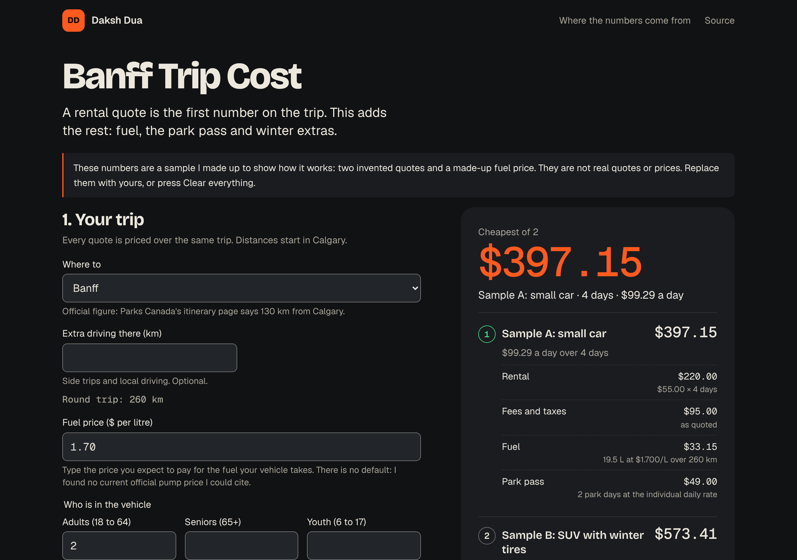

# Banff Trip Cost

**The whole number before you book: rental, fuel, park pass and winter extras, ranked.**

[**Try it live**](https://daksh2197.github.io/banff-trip-cost/) on any phone. Free, no sign-up, works with no signal.

[](https://github.com/daksh2197/banff-trip-cost/actions/workflows/ship.yml)
[](https://github.com/daksh2197/banff-trip-cost/actions/workflows/refresh-data.yml)
[](LICENSE)

<p align="center">
  
</p>

## Why I built it

A rental quote is only the first number on the trip. Fuel, the park pass and what the season adds all move the total, and they depend on what you drive and how far. I wanted the whole number before booking, not the headline one.

So you paste the totals from each offer, pick a route, and the page adds the rest. Every line is on screen. The quote at the top is the one that costs least over the whole trip. The lowest daily rate can lose.

The numbers in the demo are samples I made up. They are not real quotes.



## What it does

- **Prices each quote over the same trip.** Rental (daily rate times days), the fees and taxes as quoted, fuel, the Parks Canada pass, and any winter extras you add, such as tires, chains, extra insurance or a second driver.
- **Ranks them.** Cheapest total first. Equal totals share a rank and keep the order you typed them in. Each one shows its cost per day.
- **Compares two quotes in one sentence.** It names the line with the biggest gap, the demo says "Small car costs $176.26 less than SUV over the whole trip. The biggest gap is the rental itself (daily rate times days): $68.00 lower for Small car."
- **Works out the fuel from the vehicle.** Fuel use comes from Natural Resources Canada's Fuel Consumption Ratings, picked by model or by class average, or typed by you. The fuel price is always typed by you.
- **Knows the park pass rules it can check.** Daily admission or the Discovery Pass, whichever is cheaper for your party, with the family and group rate for up to 7 in a vehicle. Youth are free. You enter the number of park days.
- **Asks instead of guessing.** A blank fuel price, blank park days, a route with no official distance, a zero or a negative where one makes no sense: the page says what is missing and shows no total.
- **Shares the whole trip in a link.** The numbers ride after the `#`, which browsers never send to a website.
- **Works with no signal** once it has loaded once. Add `?embed=1` to hide the page around it.
- **Shows where every number comes from**, with a date, in the "Where the numbers come from" section.

I cut the Kananaskis free days, a travel-month tire advisory, miles per gallon and a French interface. They are in "What's next".

## The hard part in 30 seconds

The fuel ratings change every model year, and I did not want anyone, me included, to copy a spreadsheet into the repo by hand. So a script does it.

```
monthly timer -> download the CSV -> read every row -> check the whole file -> write two small JSON files -> commit -> deploy
                                          |                      |
                                bad row: counted and left out     any check fails: stop, keep the old data
```

The checks have numbers on them. The file must have at least 200 usable rows. No more than 5% of rows may be bad. The model year I asked for must be in it. A new file smaller than 70% of what is already in the repo is refused. A download that is really a web page saved as a CSV is refused. If anything fails the workflow goes red and the site keeps serving last month's data.

The long version, including how the portal's redirect works and what I could not verify, is in [docs/THE-PIPELINE.md](docs/THE-PIPELINE.md).

When this repo was first built, the machine that built it could not reach open.canada.ca. The pipeline is tested against a local server that redirects the way the portal does and against invented fixtures, but it has not yet downloaded the real file. Until the first run of the **Refresh data** workflow, `public/data/vehicles.json` is empty, the vehicle picker is hidden, and you type your fuel use in L/100 km. Everything else works.

## Run it yourself

You need [Node.js](https://nodejs.org) 22.12 or newer.

```bash
git clone https://github.com/daksh2197/banff-trip-cost.git
cd banff-trip-cost
npm ci
npm run dev           # the app, live-reloading, at http://localhost:5173
npm test              # 130 tests, about two seconds
npm run build         # the finished site, in dist/
npm run data:refresh  # download and check the ratings (needs network access to open.canada.ca)
```

## How it's built

| Piece | Job | Why this one |
| --- | --- | --- |
| TypeScript, strict | The language | It catches "you passed a word where a number goes" before the app runs |
| Vite | Builds the site | One command, about 150 ms. The spec said Astro; this page is all client-side, so Astro would add a build step and nothing else |
| Vitest and fast-check | Tests | Example tests for hand-worked trips, property tests for rules that must hold for any input |
| No UI framework | The screen | One page with a form and a list |
| tsx | Runs the pipeline | The data job shares its types and checks with the app, so it is TypeScript too |
| Service worker | Offline | Saves the app on the phone the first time it opens |
| GitHub Actions | Test, deploy, monthly data job | Two workflow files |
| GitHub Pages | Hosting | Free |

The map:

```
src/
  core/              the brain: no screen, no network, just numbers
    parse.ts         reads what people type: money, prices, distances, days
    fuel.ts          litres and fuel cost, in whole integers
    pass.ts          Parks Canada daily and Discovery pass rules
    trip.ts          one quote's total, and the ranking
    compare.ts       the two-quote sentence
    evaluate.ts      form text in, numbers or reasons out
    share.ts         a trip to a link and back, treating the link as hostile
    vehicles.ts      the vehicle type, checks and search
    state.ts         what the form holds, and the sample trip
    format.ts        numbers to text
    *.test.ts        the tests, next to the code they check
  data/reference.json  pass prices, routes, winter rules, sources: typed by hand, with dates
  ui/dom.ts          builds the page out of text nodes
  main.ts            wires the form to the brain and the brain to the screen
  styles/            brand.css is the dakshdua.ca palette, copied unchanged. fonts.css loads the three typefaces from the app's own files
pipeline/            the monthly data job
  csv.ts ratings.ts validate.ts sources.ts run.ts
  pipeline.test.ts testkit.ts   its tests, and a generator of invented CSVs
  fixtures/          invented CSVs for the awkward cases
public/data/         what the job writes: vehicles.json and provenance.json
public/sw.js         the offline worker (public/ also holds the icons, the manifest and the font notice)
scripts/             stamp-sw.mjs versions the worker at build time; make-icons.mjs drew the icons
docs/                CTO notes, the pipeline, the business case, screenshots
.github/workflows/   ship.yml (test and deploy), refresh-data.yml (monthly)
```

Want the guided tour? [docs/CTO-NOTES.md](docs/CTO-NOTES.md) explains each idea in plain English, how to debug it, and five small changes to try. The money side is in [docs/BUSINESS.md](docs/BUSINESS.md).

## Where the data comes from

- **Fuel ratings.** Natural Resources Canada, [Fuel Consumption Ratings](https://open.canada.ca/data/en/dataset/98f1a129-f628-4ce4-b24d-6f16bf24dd64), licensed under the [Open Government Licence – Canada](https://open.canada.ca/en/open-government-licence-canada). Contains information licensed under the Open Government Licence – Canada. The dates the job read the file are in `public/data/provenance.json` and on the page.
- **Park prices, the Kananaskis price, distances, winter tire rules.** Read by hand from the official Parks Canada and Government of Alberta pages on 2026-10-13. The pages and their dates are listed in `src/data/reference.json` and on the page. Prices are facts. Parks Canada's wording is summarised, not copied.
- **Fuel price.** Typed by you. I found no current official pump price I could cite, so there is no default.

Not affiliated with Parks Canada, Natural Resources Canada, the Government of Alberta or any rental company. No rental company is named, ranked or linked, and nothing is fetched from a rental site.

This is a calculator, not financial advice. Park fees and rules change, so check the Parks Canada page before you book.

## What got caught along the way

- **A label that fell apart on a phone.** At 320 pixels wide, "Fuel" and "Park pass" in the cost lines broke into one letter per row, because the page lets long words wrap anywhere and the grid took that as permission. I found it by looking at the screenshot. The label column now sizes to its text.
- **A typo that read as a sentence.** The over-a-million message came out as "That the daily rate is over $1,000,000". It is a test now.
- **A decimal point or a thousands mark.** "1.234" means one-and-a-bit to some people and one thousand two hundred thirty-four to others. For money and fuel the reader refuses a third decimal and says so. For kilometres it asks you to write 1200 or 1,200. It never guesses.
- **Old data served from the cache.** The offline worker first answered every file from its saved copy, including the monthly data. An outside review simulated a data deploy and found a phone still showing the old file for three visits. The worker now asks the network first for `/data/` files and only falls back to its copy when there is no signal.
- **Five things an outside review found that my tests had missed.** Before this went public it got a cold read from a second Claude session that had not seen it being built. It re-derived the maths with its own checks (20,000 random fuel cases against an exact-fraction oracle, 200,000 random strings through the number reader) and found no wrong totals. It found these instead. A blank "park days" box priced the pass at $0 and showed a total, so a blank now asks. Two vehicles that differed only in their ratings shared one picker key, so picking the first could apply the second's rating, so the key now includes every field. The offline worker held old data for three visits, described above. The compare table was cut off at 320 pixels wide, so on a phone each line is now a small card. And two sentences in these docs described a browser test that is not in the repo, so I took them out. All five are fixed, and the first two have tests.
## How this was built

I build with Claude as my pair programmer. I bring the problem and decide what the thing should do. Claude writes most of the code. I review it until I can explain every file, and [the CTO notes](docs/CTO-NOTES.md) are my study guide, in public. Every commit carries the co-author line.

## What's next

- [ ] Run the **Refresh data** workflow once and confirm the real file reads. The header names are matched from Natural Resources Canada's published column list and have not been seen in the real file yet
- [ ] A French interface and the French ratings file. I did not read the French file, so its headers and decimal comma are untested
- [ ] More model years than the current one
- [ ] The Kananaskis free days
- [ ] A travel-month tire advisory
- [ ] Read the Parks Canada fee table in the monthly job, so the prices stop being typed by hand
- [ ] Miles per gallon next to L/100 km

Ideas and pull requests are welcome. If a total looks wrong, [open an issue](https://github.com/daksh2197/banff-trip-cost/issues) with the link from **Copy link to this trip**.

## License

[MIT](LICENSE). The ratings and the park figures keep their own terms, listed above. The three typefaces (Bricolage Grotesque, Geist, Geist Mono) are shipped under the SIL Open Font License 1.1; the notice is in [public/THIRD-PARTY-NOTICES.txt](public/THIRD-PARTY-NOTICES.txt).

Built in Calgary by [Daksh Dua](https://dakshdua.ca).
